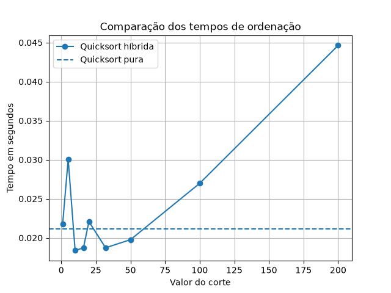

# Relatório — Quicksort Híbrida

# Gráfico dos resultados
O melhor resultado foi obtido com o corte 32, com tempo de 0,016585 segundos e ganho de 22,7% em relação à Quicksort pura (0,021455 segundos).
Cortes muito grandes, como 100 e 200, aumentaram o tempo de execução. Com corte igual a 1, a versão híbrida se comporta como a Quicksort pura, pois o Insertion Sort não é utilizado em listas com mais de um elemento.

## Gráfico dos resultados
O gráfico apresenta a comparação entre os tempos de execução da Quicksort híbrida para diferentes valores de corte e o tempo da Quicksort pura.

## Melhor valor de corte e ganho
O melhor valor de corte foi 32, com tempo de execução de 0,016585 segundos. A Quicksort pura levou 0,021455 segundos. Portanto, a versão híbrida apresentou um ganho de aproximadamente 22,7% no tempo de execução.

## O que acontece com cortes grandes demais?
Quando o corte é muito grande, o Insertion Sort precisa ordenar partes maiores da lista e pode ficar menos eficiente. Nos testes, o corte 200 apresentou o maior tempo de execução, de 0,038241 segundos.

## Confirmação de que corte = 1 se comporta como a Quicksort pura
No código, o Insertion Sort só é utilizado quando `len(lista) < corte`. Quando o corte é igual a 1, essa condição não é satisfeita para listas com mais de um elemento. Assim, a versão híbrida se comporta como a Quicksort pura. Os tempos medidos podem apresentar pequenas diferenças devido às variações na execução.
